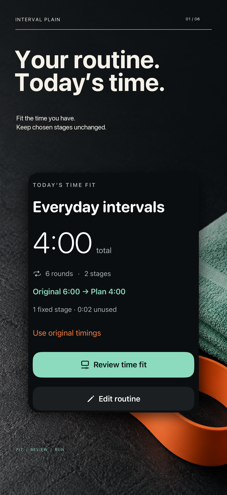
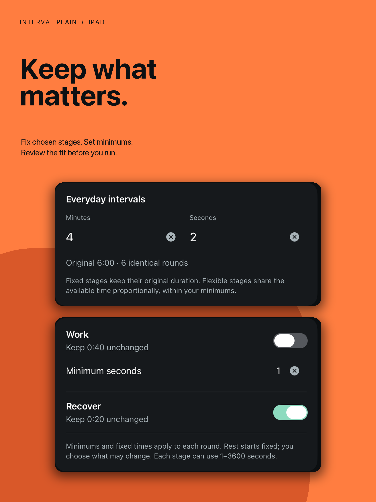

# Interval Plain · Time-fit Routine Planner

**Your routine. Today’s time.** A native iPhone/iPad workflow for fitting a reusable routine to the available time while preserving chosen stages and the original routine.

**October 19, 2026 at 5:54 PM PDT: version 1.0 (4) and Lifetime Pro resubmitted; both Waiting for Review.** Apple validation/upload/processing passed; twelve revised screenshots and planner metadata included. Manual release enabled. Build 3’s prior 4.3(a) rejection/Board appeal is historical; no duplicate appeal filed. No approval or public release claimed.

- Set minutes/seconds, keep important stages fixed and choose minimums for flexible stages.
- Inspect every original/fitted duration, explicit unused seconds and infeasible minimums.
- Reuse a separate plan, share actual timing text and recover the fitted sequence paused.
- iPad gets a two-column planning workspace; phone and larger text stack naturally.
- Time fitting and one reusable routine are free. Optional Lifetime Pro adds a named library, duplication and ordering with one purchase.

| iPhone | iPad |
| --- | --- |
|  |  |

Swift, SwiftUI, AVFoundation and StoreKit 2; iOS/iPadOS 15+ minimum. Deterministic bounded allocation with stable whole-second rounding, validated atomic persistence and checkpoint recovery. Keep the app open while timing; locking/leaving pauses. No deadline/background-cue guarantee.

Build 4: 25 core tests, native model and local StoreKit tests, phone/iPad workflows, accessibility and small-phone iOS17 maximum-text checks passed. Current physical-device, actual iOS15 and Apple-server billing remain unverified. TestFlight skipped by publisher instruction.

No account, ads, remote analytics or developer upload service. Routines/plans stay on-device unless deliberately shared or included in a device backup. Commercial source remains private; this repository contains curated product material.

[Product and complete campaigns](https://sepidehdalir.github.io/intervalplain-showcase/) · [iOS portfolio](https://github.com/sepidehdalir/ios-app-portfolio) · [Support](support.html) · [Privacy](privacy.html)

Sepideh Javanbakht Dalir · [arvinify.com](https://www.arvinify.com) · [hello@arvinify.com](mailto:hello@arvinify.com)
