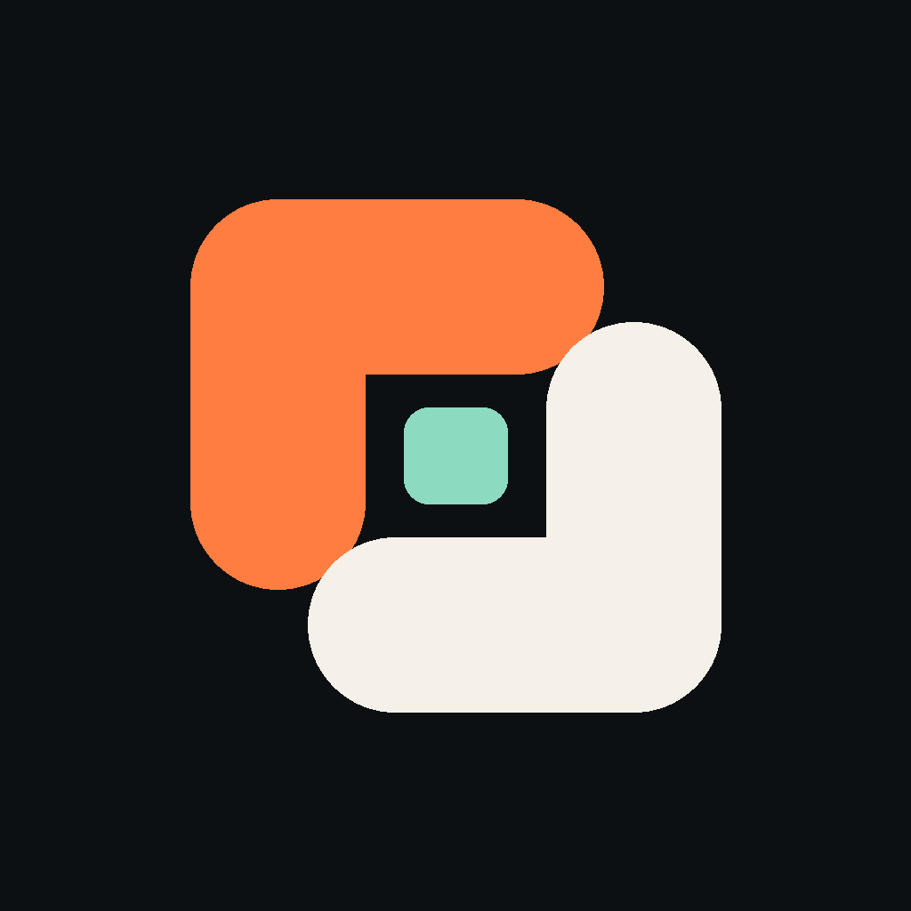
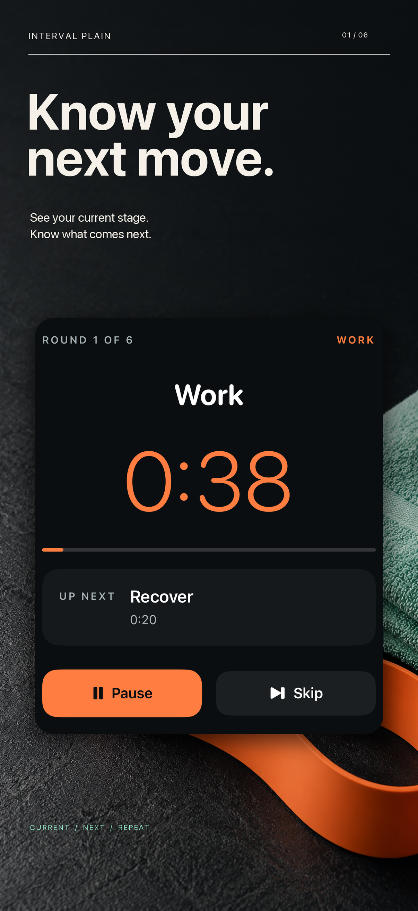
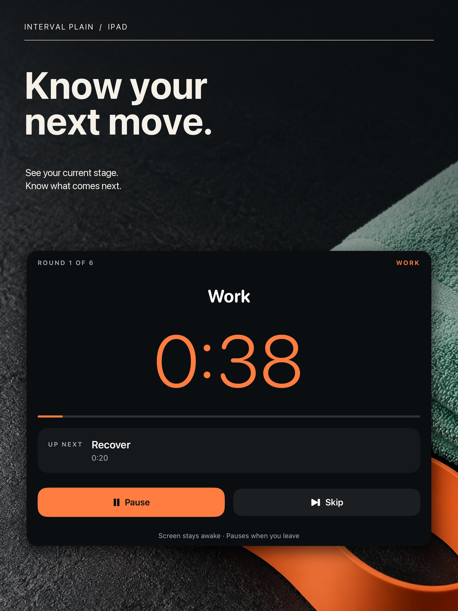

# Interval Plain · Routine Timer

**Current App Review status — October17,2026:** Rejected; clarification/reconsideration is in progress. Not publicly released. Earlier submission milestones below are historical.

**A native iPhone and iPad timer for work/rest routines, spoken cues and a reusable local library.**

One reusable custom routine is free. Optional Lifetime Pro adds multiple saved routines, duplication and reordering. The interface keeps the current stage, remaining time and next stage together, with clear foreground timing and interruption behavior.

## Product and engineering

Built with **Swift, SwiftUI, AVFoundation and StoreKit 2**, targeting iOS/iPadOS 15+.

- Continuous-clock timing with explicit detection of missed stage boundaries.
- On-device speech and atomic local persistence.
- Paused recovery after interruptions, with clear foreground-use expectations.
- Verified entitlement handling and a useful free routine before the optional upgrade.
- Separate iPhone and iPad marketing compositions using genuine app captures.

| iPhone campaign | iPad campaign |
| --- | --- |
|  |  |

## Release status

**Submitted for App Review on October 15, 2026 at 23:57 PDT:** version **1.0 (3)** and **Lifetime Pro** were **Waiting for Review** at the verified submission receipt. Manual release is enabled. The app is not yet verified as publicly available; there is no live App Store download link here.

TestFlight is skipped by publisher instruction. Compilation, runtime checks, local purchase fixtures, submission and public release are separate verification milestones; this page does not claim a production purchase or released build.

## Privacy and source

No account, advertising, product backend or developer data collection. Commercial engineering source is private; this repository contains curated product, support, privacy and marketing material.

[All iOS case studies](https://github.com/sepidehdalir/ios-app-portfolio) · [Support](support.html) · [Privacy](privacy.html)

**Sepideh Javanbakht Dalir** · [arvinify.com](https://www.arvinify.com) · [hello@arvinify.com](mailto:hello@arvinify.com)
